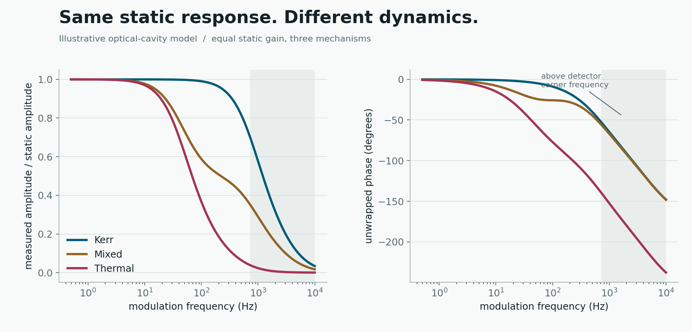

# virtual optics bench

a small, hardware-free experiment in keeping rival physical explanations alive.

turn up the input power on an optical cavity and its resonance moves. a fast Kerr response and slower heating can look the same at equilibrium. rather than picking a mechanism from that sweep alone, fit a set of hypotheses, then choose a modulation frequency where their predictions differ **after** accounting for what the cavity and detector can transmit.

## what is actually modeled

this is a normalized, small-signal bench, not a device digital twin. the drive perturbs circulating power; the optical pole limits how fast that power can respond. the Kerr term follows circulating power promptly on the modeled timescales, while the thermal term follows a relaxation equation. a readout pole filters their combined detuning before measurement. in the candidate model,

    shift(f) / drive(f) = gain × cavity(f) × detector(f)
                          × ((1 − thermal_fraction) + thermal_fraction × thermal(f))

where each first-order response is 1 / (1 + 2π i f τ), with f in Hz and τ in seconds. at equilibrium all these response factors are 1. a static slope estimates total gain, but cannot identify the thermal fraction or time constant. phase and amplitude at new frequencies can help. the first-order optical response is a local approximation, not a Maxwell solver or a model of optical bistability.

the benchmark simulates the *measurement*, not just the hidden physical state. a held-out truth generator is kept separate from the inverse model. judge mechanism identification and model rejection separately: a model can be the closest one on the menu and still be inadequate, and an omitted mechanism can look plausible at the frequencies you measure.

## boundaries

- synthetic traces only. no laser, experimental data, or real-device performance claim.
- this is one domain and one small set of candidate mechanisms; not cross-domain validation.
- a numerically more faithful solver is not an independent experiment. validation on an actual setup is a separate step.

## reading

- [Kerr and thermal response in an optical microcavity](https://opg.optica.org/ol/abstract.cfm?uri=OL-30-4-427) is experimental motivation, not the source of this benchmark's numerical parameters.
- [FMI](https://fmi-standard.org/docs/main/) is a reference for model interchange and co-simulation; this prototype does not implement the standard.



The plot uses illustrative time constants and is not a benchmark observation.

## run it

Use Python 3.10 or newer with NumPy and SciPy. From this directory:

```sh
python -m pip install -r requirements.txt
python -m opticsbench
python -m opticsbench.evaluate --output results/benchmark.json
python -m unittest discover -s tests
```

`python -m opticsbench` prints a sample design ranking, not a benchmark result.
To inspect a custom synthetic calibration, pass a JSON file with arrays
`power`, `shift`, and a positive `static_noise_sd`. Optionally supply
`frequencies_hz` and `observed_iq` as rows of `[Hz, real, imaginary]`.
These are normalized pedagogical units. Information scores are approximate
and conditional on the assumed model menu and observation model.

See [evaluation protocol](benchmark-protocol.md) for the score definitions
and split. The figure can be regenerated with Matplotlib using
`python scripts/illustrate.py`.

## v1: one dynamic measurement

The fixed comparator chose 300 Hz using 216 development cases. The
bandwidth-aware selector picked that same frequency on all 768 fresh test
cases. Both got **541/576 (93.9%)** supported cases right, with 32 unresolved,
three wrong mechanism assignments and no explicit false rejections. This is
an exact tie, not an adaptive gain.

Out of 192 two-thermal-pole cases, **180 (93.8%)** were incorrectly assigned a
known mechanism (177 were called mixed Kerr and heating), 12 were unresolved,
and zero were explicitly rejected. This is the central failure. After
removing the common optical and detector filters, a single complex phasor
can fall exactly on a Kerr-plus-one-thermal-pole prediction even when there
is no Kerr term at all.

Dropping the optical and detector limits while ranking (but not while reading
or classifying measurements) changed 298/768 frequency choices and reduced
supported-case accuracy to 453/576 (78.6%). That shows the value of modeling
the instrument on this synthetic bench. It is not evidence of better
recognition of omitted mechanisms: the less effective method was more often
uncertain. See `results/benchmark.json` for every decision and the paired
bootstrap intervals.

See [the aliasing derivation](one-frequency-aliasing.md) for the exact
one-frequency equivalence and an example that breaks across frequencies.

## v2: repeat or change frequency?

With two equal-precision feature queries on 768 fresh synthetic cases,
the first 300 Hz observation is shared. The second is either a repeat at
300 Hz or a new observation at 1,000 Hz.

| test result | repeat 300 Hz | add 1,000 Hz |
| --- | ---: | ---: |
| correct among 576 supported cases | 539 | 543 |
| false rejections among 576 supported cases | 8 | 3 |
| rejected among 192 omitted-mechanism cases | 0 | 60 |
| unresolved among 192 omitted-mechanism cases | 6 | 26 |
| incorrectly assigned a mechanism among 192 omitted-mechanism cases | 186 | 106 |

The second frequency increased explicit omitted-case rejection by
31.25 percentage points (paired 95% interval 25.0–38.0), with no
clear supported-case accuracy change (+0.69 points, interval −1.39 to
+2.78). More than half of omitted cases were still incorrectly assigned a
mechanism. The test supports varying the input over repeating it on this
bench, not reliable unknown-mechanism detection or a win for adaptivity.

```sh
python -m opticsbench.two_query --output results/two-query.json
```

See [the follow-up protocol](TWO-QUERY.md) for gates and limitations. The
benchmark models equal-cost feature queries, not equal physical test time.
